# Kasirku
[](https://github.com/Dylan-Akmal/kasirku/actions/workflows/backend-tests.yml)

Aplikasi kasir (Point of Sale) untuk usaha kecil seperti warung, toko kelontong, dan kedai kopi. Terdiri dari REST API (Laravel), aplikasi web untuk admin dan kasir (Vue 3), dan aplikasi mobile untuk kasir (Flutter).

## Fitur

**Kasir (web dan mobile)**
- Halaman kasir dengan pencarian produk, filter kategori, dan scan barcode (di web: pemindai USB mengetik SKU lalu Enter; di mobile: ketik SKU lalu tekan cari)
- Keranjang dengan batas jumlah sesuai stok, diskon nominal atau persen, dan pembayaran tunai, QRIS, atau transfer
- Hitung kembalian otomatis dan struk (web: bisa dicetak; mobile: bisa disalin)
- Riwayat transaksi milik sendiri dengan filter tanggal dan status, detail, dan struk

**Admin (web)**
- Semua fitur kasir, ditambah manajemen produk, kategori, dan foto produk
- Stok masuk, penyesuaian stok (stock opname), dan riwayat pergerakan stok
- Pembatalan (void) transaksi dengan alasan, dan stok otomatis dikembalikan
- Laporan penjualan: ringkasan, grafik omzet harian, per metode bayar, per kasir, produk terlaris, dan ekspor CSV
- Manajemen akun kasir (tambah, ubah, reset kata sandi, aktifkan atau nonaktifkan) dan pengaturan profil toko

## Teknologi

| Bagian | Teknologi |
|---|---|
| Backend | Laravel 12, Laravel Sanctum (token Bearer), MySQL |
| Web | Vue 3, Vite, Tailwind CSS, Pinia, Vue Router, Axios |
| Mobile | Flutter, Provider, Dio |

## Tangkapan layar

### Web

| Login | Dashboard |
|---|---|
| 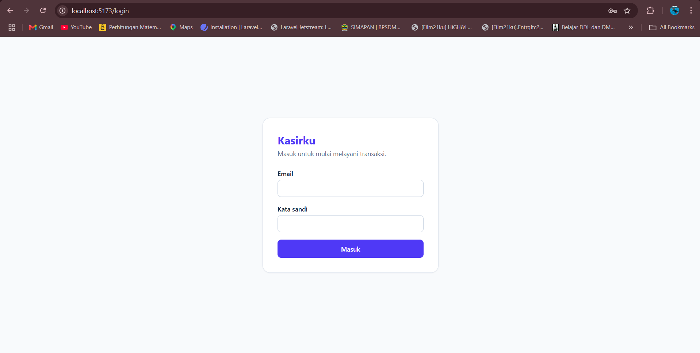 | 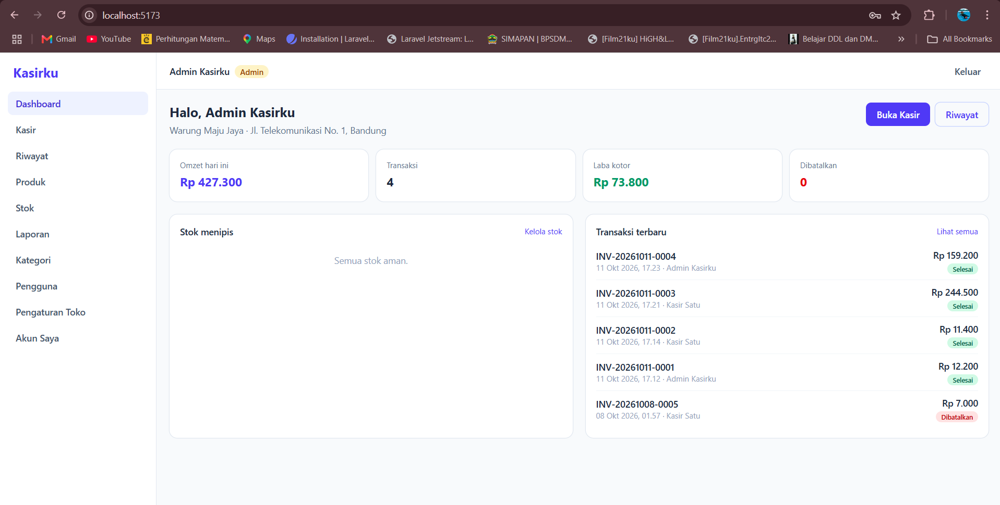 |

| Kasir (POS) | Struk |
|---|---|
| 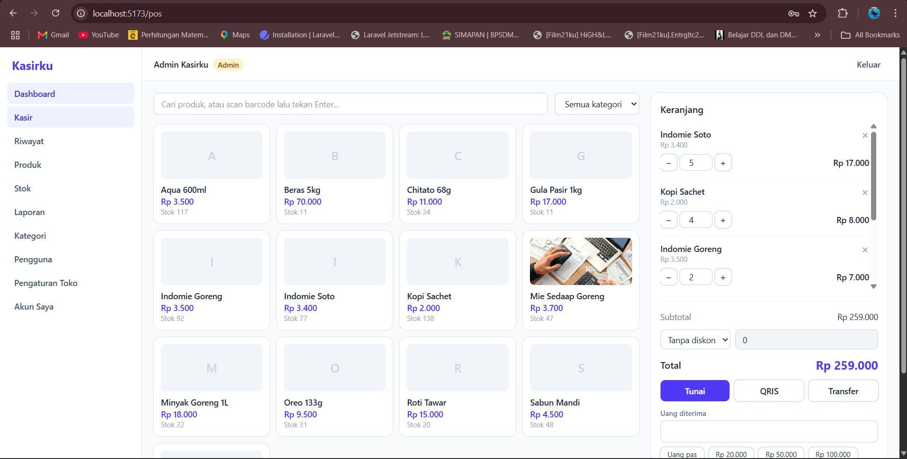 | 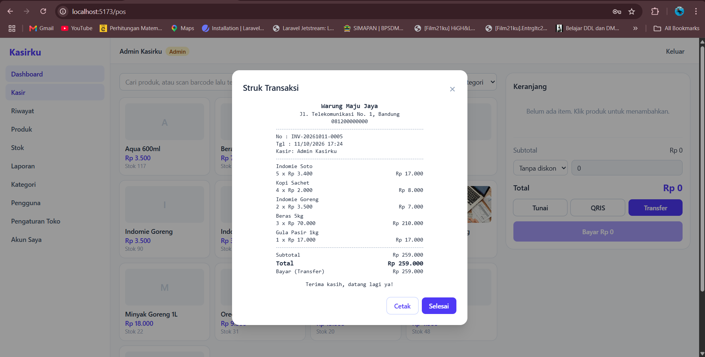 |

| Produk | Riwayat Transaksi |
|---|---|
| 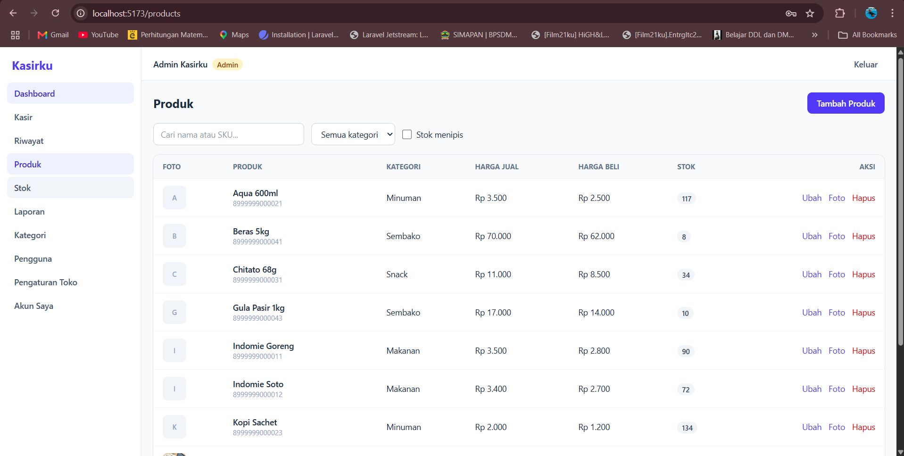 | 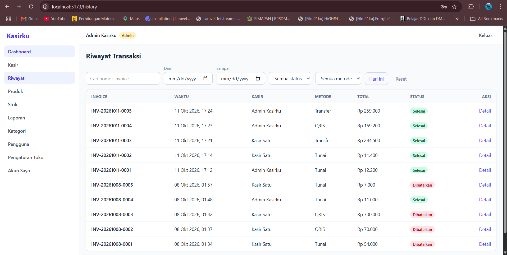 |

| Riwayat Stok | Laporan |
|---|---|
| 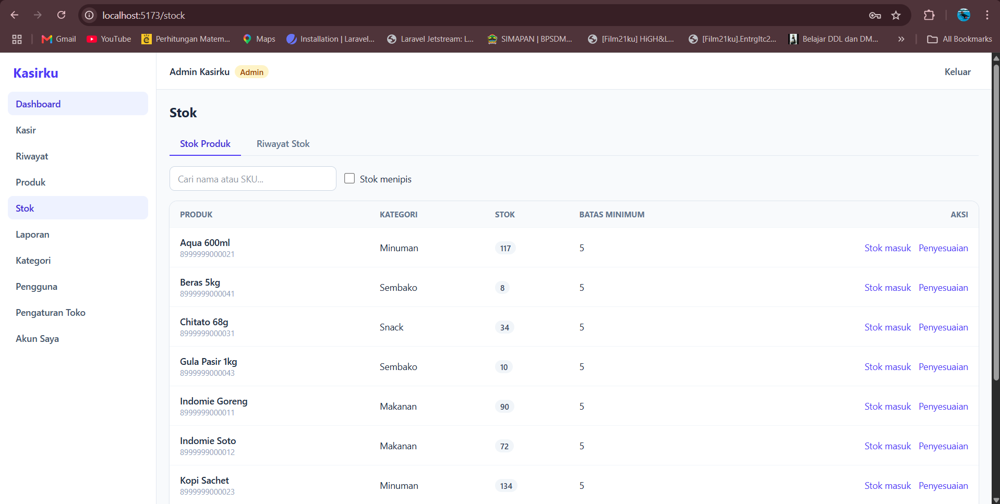 | 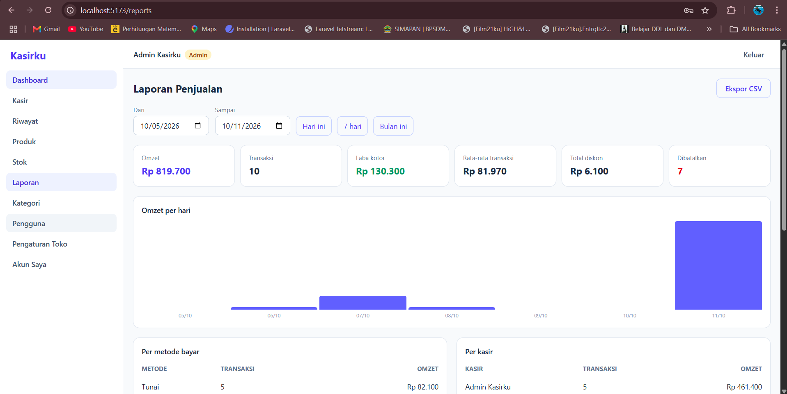 |

### Mobile

| Login | Kasir | Keranjang |
|---|---|---|
| 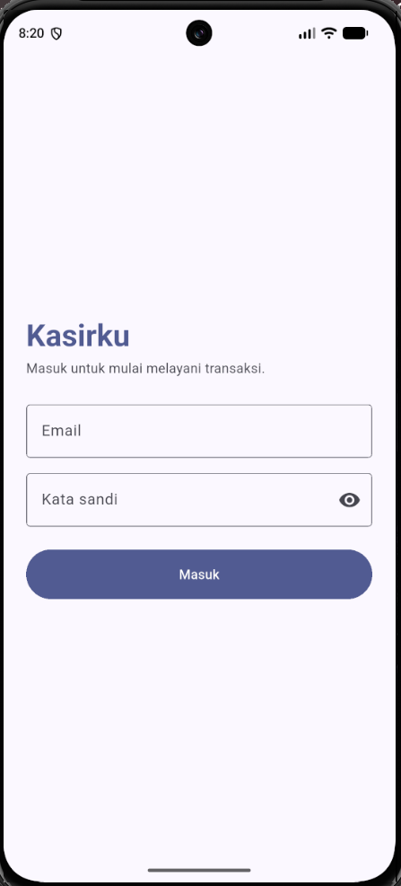 | 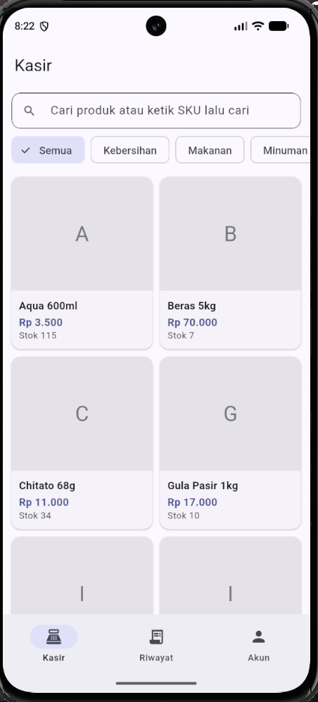 | 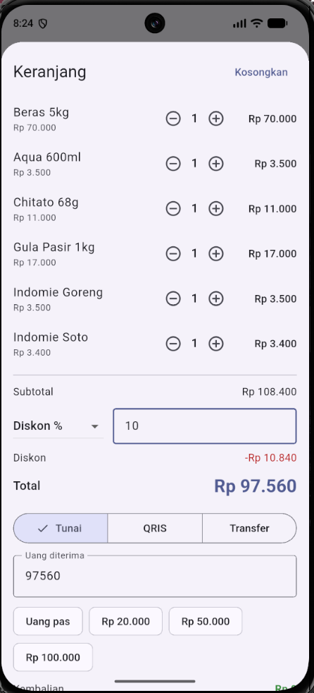 |

| Struk | Riwayat | Detail Transaksi |
|---|---|---|
| 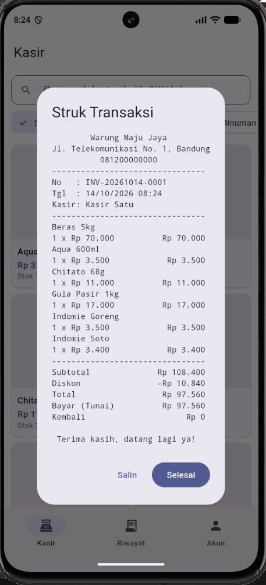 | 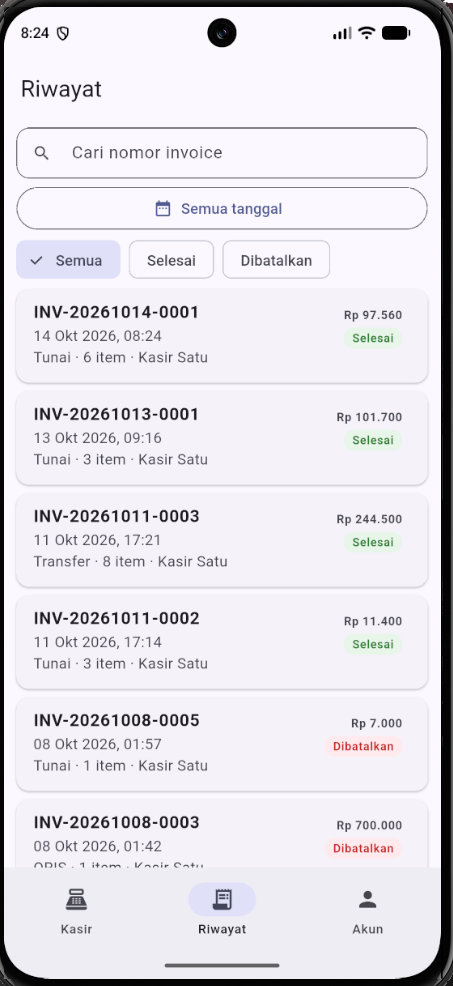 | 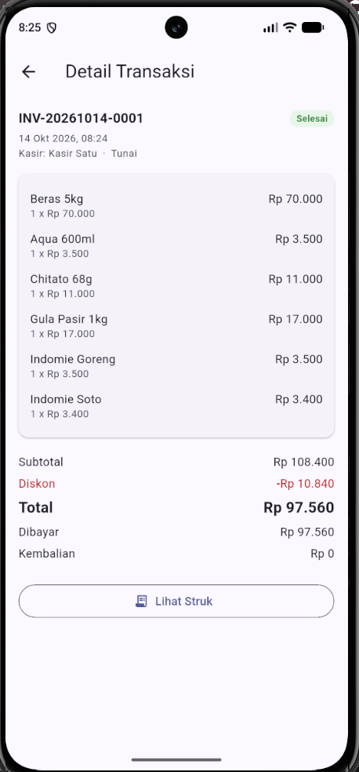 |

## Struktur repositori

```
kasirku/
├── backend/   REST API Laravel
├── web/       Aplikasi web Vue 3
├── mobile/    Aplikasi mobile Flutter (kasir)
└── docs/      SRS, ERD, dan tangkapan layar
```

## Menjalankan secara lokal

### Prasyarat

PHP 8.2 atau lebih baru, Composer, MySQL (misalnya lewat XAMPP), Node.js 20 atau lebih baru, dan untuk aplikasi mobile Flutter SDK serta Android Studio dengan emulator Android.

### Backend

Buat database kosong bernama `kasirku` di MySQL, lalu jalankan:

```bash
cd backend
composer install
cp .env.example .env
php artisan key:generate
```

Ubah pengaturan database di `backend/.env`:

```env
DB_CONNECTION=mysql
DB_HOST=127.0.0.1
DB_PORT=3306
DB_DATABASE=kasirku
DB_USERNAME=root
DB_PASSWORD=
```

Lanjutkan dengan migrasi, data awal, tautan penyimpanan foto, dan server:

```bash
php artisan migrate --seed
php artisan storage:link
php artisan serve
```

API berjalan di `http://127.0.0.1:8000/api`.

### Web

```bash
cd web
npm install
npm run dev
```

Aplikasi web berjalan di `http://localhost:5173`. Alamat API dapat diubah lewat variabel `VITE_API_URL` di `web/.env` (bawaan: `http://127.0.0.1:8000/api`).

### Mobile

Pastikan backend sudah berjalan, lalu nyalakan emulator Android dan jalankan:

```bash
cd mobile
flutter pub get
flutter run
```

Alamat API diatur di `mobile/lib/core/config.dart`. Nilai bawaan `http://10.0.2.2:8000/api` dipakai untuk emulator Android (alamat `10.0.2.2` menunjuk ke komputer host). Untuk HP asli, ganti dengan alamat IP komputer di jaringan WiFi yang sama, dan jalankan backend dengan `php artisan serve --host=0.0.0.0`.

### Pengujian

Backend memiliki feature test (PHPUnit) yang berjalan di SQLite memori, sehingga tidak menyentuh database MySQL:

```bash
cd backend
php artisan test
```

Cakupannya meliputi autentikasi, hak akses peran, checkout (stok, diskon, kembalian, dan pembatalan menyeluruh bila gagal), pembatalan transaksi (void), dan laporan penjualan. Tes dijalankan otomatis lewat GitHub Actions setiap ada perubahan di folder `backend`.

### Akun uji

Dibuat oleh seeder, khusus untuk pengembangan. Ganti kata sandinya sebelum dipakai di lingkungan sebenarnya. Aplikasi mobile ditujukan untuk kasir, sedangkan fitur admin ada di web.

| Peran | Email | Kata sandi |
|---|---|---|
| Admin | admin@kasirku.test | password |
| Kasir | kasir@kasirku.test | password |

## Ringkasan API

Semua rute berawalan `/api` dan memakai header `Authorization: Bearer <token>` kecuali login.

| Metode | Endpoint | Akses | Keterangan |
|---|---|---|---|
| POST | `/login` | Publik | Login dan mendapatkan token |
| POST | `/logout`, GET `/me`, PUT `/password` | Login | Sesi dan kata sandi sendiri |
| GET | `/store-settings` | Login | Profil toko |
| PUT | `/store-settings` | Admin | Ubah profil toko |
| GET | `/categories` | Login | Daftar kategori |
| POST, PUT, DELETE | `/categories` | Admin | Kelola kategori |
| GET | `/products`, `/products/{id}` | Login | Cari, filter, dan detail produk |
| POST, PUT, DELETE | `/products`, `/products/{id}/image` | Admin | Kelola produk dan foto |
| POST | `/products/{id}/stock-in`, `/products/{id}/stock-adjust` | Admin | Stok masuk dan penyesuaian |
| GET | `/stock-movements` | Admin | Riwayat pergerakan stok |
| GET, POST | `/transactions` | Login | Riwayat dan checkout |
| GET | `/transactions/{id}`, `/transactions/{id}/receipt` | Login | Detail dan struk |
| POST | `/transactions/{id}/void` | Admin | Batalkan transaksi |
| GET | `/reports/sales`, `/reports/top-products`, `/reports/export` | Admin | Laporan dan ekspor CSV |
| GET, POST, PUT | `/users` | Admin | Kelola akun |

## Aturan bisnis penting

- Checkout berjalan dalam satu transaksi basis data: pembuatan transaksi, pengurangan stok, dan pencatatan pergerakan stok berhasil atau gagal bersama-sama, dengan penguncian baris produk agar stok tidak minus.
- Harga beli dan harga jual disimpan sebagai snapshot di setiap item transaksi, sehingga perubahan harga tidak memengaruhi data lama.
- Transaksi yang sudah selesai tidak dapat diubah atau dihapus, hanya dibatalkan oleh admin.
- Produk yang dihapus memakai soft delete agar riwayat transaksi tetap utuh.
- Kasir hanya melihat transaksi miliknya dan tidak melihat harga beli.
- Nomor invoice berformat `INV-YYYYMMDD-NNNN` dan urutannya kembali ke 0001 setiap hari.

## Dokumentasi

- [Software Requirements Specification](docs/SRS.md)
- [Entity Relationship Diagram](docs/ERD.md)

## Rencana pengembangan

- Scan barcode lewat kamera di aplikasi mobile
- Bagikan struk dari aplikasi mobile (WhatsApp dan sejenisnya)
- Cetak struk ke printer thermal Bluetooth