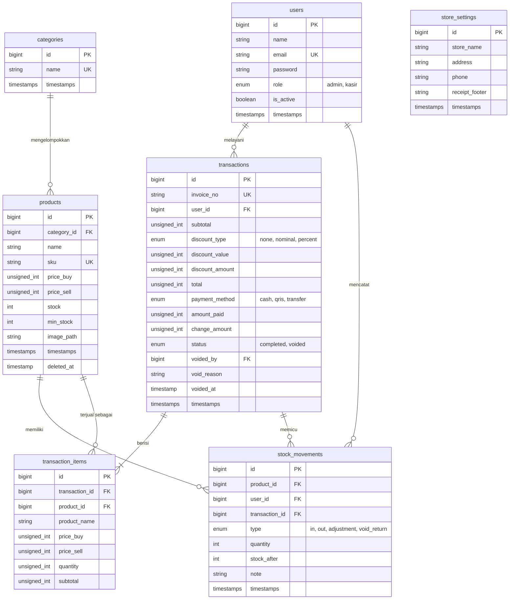

# Entity Relationship Diagram (ERD)

## Kasirku - Aplikasi Kasir (Point of Sale)

| Atribut | Keterangan |
|---|---|
| Versi dokumen | 1.0 |
| Tanggal | 2 Oktober 2026 |
| Penulis | Dylan Akmal Adi Mahendra |
| Status | Draft |

Dokumen ini menjelaskan rancangan basis data Kasirku (MySQL) dan menjadi acuan pembuatan migration Laravel. Kebutuhan yang mendasarinya ada di docs/SRS.md.

---

## 1. Diagram

---

## 2. Kamus Data

### 2.1 users
Menyimpan akun admin dan kasir.

| Kolom | Tipe | Keterangan |
|---|---|---|
| id | BIGINT UNSIGNED, PK | Auto increment |
| name | VARCHAR(100) | Nama pengguna |
| email | VARCHAR(150), unik | Dipakai untuk login |
| password | VARCHAR(255) | Hash kata sandi |
| role | ENUM('admin','kasir') | Peran pengguna, default 'kasir' |
| is_active | BOOLEAN | Akun nonaktif tidak dapat login, default true |
| created_at, updated_at | TIMESTAMP | Waktu dibuat dan diubah |

### 2.2 categories
Kategori produk, misalnya Makanan, Minuman, Rokok, Sembako.

| Kolom | Tipe | Keterangan |
|---|---|---|
| id | BIGINT UNSIGNED, PK | Auto increment |
| name | VARCHAR(100), unik | Nama kategori |
| created_at, updated_at | TIMESTAMP | Waktu dibuat dan diubah |

### 2.3 products
Daftar barang yang dijual.

| Kolom | Tipe | Keterangan |
|---|---|---|
| id | BIGINT UNSIGNED, PK | Auto increment |
| category_id | BIGINT UNSIGNED, FK, nullable | Merujuk ke categories.id; diisi NULL bila kategori dihapus |
| name | VARCHAR(150) | Nama produk |
| sku | VARCHAR(50), unik, nullable | Kode produk atau barcode |
| price_buy | INT UNSIGNED | Harga beli (modal) dalam Rupiah |
| price_sell | INT UNSIGNED | Harga jual dalam Rupiah |
| stock | INT | Stok saat ini |
| min_stock | INT | Batas stok menipis, default 5 |
| image_path | VARCHAR(255), nullable | Lokasi foto produk |
| created_at, updated_at | TIMESTAMP | Waktu dibuat dan diubah |
| deleted_at | TIMESTAMP, nullable | Penanda soft delete |

### 2.4 stock_movements
Riwayat setiap perubahan stok sehingga stok dapat diaudit.

| Kolom | Tipe | Keterangan |
|---|---|---|
| id | BIGINT UNSIGNED, PK | Auto increment |
| product_id | BIGINT UNSIGNED, FK | Merujuk ke products.id |
| user_id | BIGINT UNSIGNED, FK | Pengguna yang memicu perubahan |
| transaction_id | BIGINT UNSIGNED, FK, nullable | Terisi bila perubahan berasal dari transaksi atau void |
| type | ENUM('in','out','adjustment','void_return') | Jenis pergerakan |
| quantity | INT | Perubahan stok; positif menambah, negatif mengurangi |
| stock_after | INT | Stok produk setelah perubahan |
| note | VARCHAR(255), nullable | Catatan atau alasan penyesuaian |
| created_at, updated_at | TIMESTAMP | Waktu dibuat dan diubah |

Makna jenis pergerakan: `in` untuk restock, `out` untuk penjualan, `adjustment` untuk stock opname, dan `void_return` untuk stok yang dikembalikan karena transaksi dibatalkan.

### 2.5 transactions
Kepala (header) transaksi penjualan.

| Kolom | Tipe | Keterangan |
|---|---|---|
| id | BIGINT UNSIGNED, PK | Auto increment |
| invoice_no | VARCHAR(30), unik | Format INV-YYYYMMDD-NNNN |
| user_id | BIGINT UNSIGNED, FK | Kasir yang melayani |
| subtotal | INT UNSIGNED | Jumlah seluruh item sebelum diskon |
| discount_type | ENUM('none','nominal','percent') | Jenis diskon, default 'none' |
| discount_value | INT UNSIGNED | Nilai yang diinput kasir (Rupiah atau persen) |
| discount_amount | INT UNSIGNED | Potongan dalam Rupiah hasil perhitungan |
| total | INT UNSIGNED | subtotal dikurangi discount_amount |
| payment_method | ENUM('cash','qris','transfer') | Metode pembayaran |
| amount_paid | INT UNSIGNED | Uang yang diterima |
| change_amount | INT UNSIGNED | Kembalian, 0 untuk non-tunai |
| status | ENUM('completed','voided') | Status transaksi, default 'completed' |
| voided_by | BIGINT UNSIGNED, FK, nullable | Admin yang membatalkan, merujuk ke users.id |
| void_reason | VARCHAR(255), nullable | Alasan pembatalan |
| voided_at | TIMESTAMP, nullable | Waktu pembatalan |
| created_at, updated_at | TIMESTAMP | Waktu dibuat dan diubah |

### 2.6 transaction_items
Rincian item pada setiap transaksi.

| Kolom | Tipe | Keterangan |
|---|---|---|
| id | BIGINT UNSIGNED, PK | Auto increment |
| transaction_id | BIGINT UNSIGNED, FK | Merujuk ke transactions.id, hapus berantai (cascade) |
| product_id | BIGINT UNSIGNED, FK | Merujuk ke products.id |
| product_name | VARCHAR(150) | Snapshot nama produk saat transaksi |
| price_buy | INT UNSIGNED | Snapshot harga beli, dipakai menghitung laba |
| price_sell | INT UNSIGNED | Snapshot harga jual saat transaksi |
| quantity | INT UNSIGNED | Jumlah yang dibeli |
| subtotal | INT UNSIGNED | price_sell dikali quantity |

### 2.7 store_settings
Profil toko untuk kepala dan kaki struk. Tabel ini hanya berisi satu baris.

| Kolom | Tipe | Keterangan |
|---|---|---|
| id | BIGINT UNSIGNED, PK | Auto increment |
| store_name | VARCHAR(150) | Nama toko |
| address | VARCHAR(255), nullable | Alamat toko |
| phone | VARCHAR(30), nullable | Nomor telepon |
| receipt_footer | VARCHAR(255), nullable | Pesan di bagian bawah struk |
| created_at, updated_at | TIMESTAMP | Waktu dibuat dan diubah |

Tabel `personal_access_tokens` untuk token Laravel Sanctum dibuat otomatis oleh Laravel dan tidak digambarkan di diagram.

---

## 3. Relasi Antartabel

| Relasi | Kardinalitas | Keterangan |
|---|---|---|
| categories ke products | 1 ke banyak | Satu kategori memiliki banyak produk; produk boleh tanpa kategori |
| users ke transactions | 1 ke banyak | Satu kasir melayani banyak transaksi |
| users ke stock_movements | 1 ke banyak | Satu pengguna mencatat banyak pergerakan stok |
| products ke stock_movements | 1 ke banyak | Satu produk memiliki banyak riwayat stok |
| products ke transaction_items | 1 ke banyak | Satu produk dapat muncul di banyak transaksi |
| transactions ke transaction_items | 1 ke banyak | Satu transaksi minimal berisi satu item |
| transactions ke stock_movements | 1 ke banyak | Satu transaksi atau void memicu pergerakan stok untuk tiap itemnya |

---

## 4. Aturan Integritas dan Catatan Desain

Soft delete pada products (kolom deleted_at) menjaga riwayat transaksi lama tetap utuh meskipun produknya sudah dihapus dari katalog (FR-09). Karena itu foreign key dari transaction_items ke products memakai aturan RESTRICT pada hapus permanen, sedangkan penghapusan biasa hanya mengisi deleted_at.

Transaction_items menyimpan snapshot nama, harga beli, dan harga jual. Dengan begitu perubahan harga di kemudian hari tidak mengubah transaksi lama, dan laba kotor per transaksi tetap bisa dihitung dengan benar (FR-23, FR-29).

Nilai uang disimpan sebagai bilangan bulat dalam Rupiah (tanpa desimal) untuk menghindari kesalahan pembulatan.

Pembuatan transaksi, pengisian transaction_items, pengurangan stok, dan pencatatan stock_movements dijalankan dalam satu transaksi basis data (DB transaction) dan memakai penguncian baris produk (lockForUpdate) agar stok tidak minus saat dua kasir menjual barang yang sama bersamaan (NFR-04, FR-21).

Transaksi tidak pernah dihapus. Pembatalan hanya mengubah status menjadi 'voided', mengisi voided_by, void_reason, dan voided_at, lalu membuat pergerakan stok bertipe void_return untuk setiap item (BR-02, FR-24). Laporan penjualan hanya menghitung transaksi berstatus 'completed'.

Nomor invoice dibuat dari tanggal hari itu ditambah urutan 4 digit yang dihitung dari jumlah transaksi pada tanggal yang sama, sehingga urutan otomatis kembali ke 0001 setiap hari (BR-06). Kolom invoice_no bersifat unik sebagai pengaman bila terjadi dua permintaan bersamaan.

Indeks tambahan yang disarankan: transactions(created_at) dan transactions(user_id, created_at) untuk laporan dan riwayat, products(name) untuk pencarian, serta stock_movements(product_id, created_at) untuk riwayat stok per produk.
